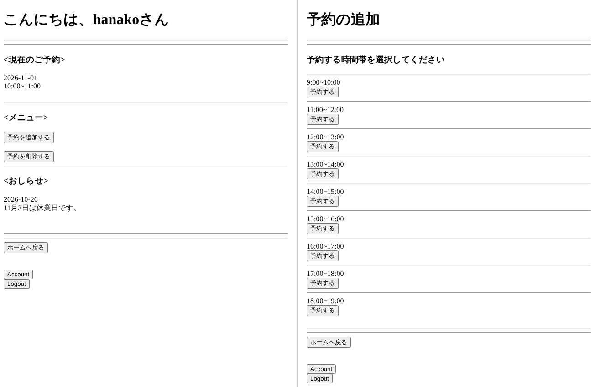

# 予約管理システム

[](https://github.com/mimish0778/reservation-system/actions/workflows/test.yml)

PHP と MySQL で作った、1 時間単位の時間枠を予約できる Web アプリケーションです。利用者は空いている時間枠の予約と取り消しができ、管理者はユーザー、予約、お知らせを管理できます。

アプリ本体は `reservation_system.php` の 1 ファイルで、フレームワークは使っていません。



ログインはセッションで管理し、パスワードのハッシュ化、プリペアドステートメント、出力のエスケープ、CSRF トークン、操作ごとの権限チェックを入れています。詳しくは「[セキュリティ対策](#セキュリティ対策)」を参照してください。

## 機能

### 利用者

- サインアップ（ユーザー名、8 文字以上のパスワード、生年月日、電話番号）とログイン
- 自分の予約の一覧表示
- 予約の追加（日付を入力し、空いている時間枠から選ぶ）
- 自分の予約の取り消し
- 自分宛て、または全員宛て（`everyone`）のお知らせの表示

### 管理者

- ユーザーの一覧表示と削除、管理者権限の付与と解除
- 全ユーザーの予約の一覧表示と削除
- お知らせの投稿（宛先、日付、本文）と削除

### 共通

- アカウント情報（パスワード、生年月日、電話番号）の変更。パスワードの変更には現在のパスワードが必要です
- ログアウト

### 予約枠

予約できるのは 9:00〜19:00 の 1 時間ごとの 10 枠です（9:00〜10:00 から 18:00〜19:00 まで）。1 つの時間枠を予約できるのは 1 人だけで、予約済みの枠は選択肢に表示されません。

## 必要な環境

- PHP 7.4 以上（`mysqli` 拡張と mysqlnd が必要）
- MySQL または MariaDB

PHP 8.3 と MariaDB 10.11 で動作を確認しています。

## セットアップ

1. リポジトリをクローンします。

   ```bash
   git clone https://github.com/mimish0778/reservation-system.git
   cd reservation-system
   ```

2. データベースとテーブルを作ります。`schema.sql` はデータベース `web_db` と 3 つのテーブルを作成します。

   ```bash
   mysql -u root -p < schema.sql
   ```

3. 接続設定ファイルを作り、自分の環境に合わせて書き換えます。

   ```bash
   cp config.example.php config.php
   ```

   ```php
   $hostname = '127.0.0.1';
   $username = 'root';
   $password = 'your_password_here';
   $dbname   = 'web_db';
   ```

   `config.php` は `.gitignore` に含まれているため、コミットされません。

4. 管理者アカウントを作ります。画面から登録したユーザーは一般ユーザーになるため、最初の管理者はコマンドラインで作成します。パスワードは画面に表示されずに入力でき、ハッシュにしてから保存されます。

   ```bash
   php create_admin.php admin
   ```

   2 人目以降は、管理者が「ユーザを管理する」画面から権限を付与できます。

5. サーバーを起動します。PHP の組み込みサーバーを使う場合は次のとおりです。

   ```bash
   php -S localhost:8000
   ```

   ブラウザで http://localhost:8000/reservation_system.php を開きます。Apache などの Web サーバーを使う場合は、リポジトリのファイルをドキュメントルートに置いてください。

## 使い方

1. ログイン画面の「Sign Up」から利用者を登録します。登録するとそのままログインした状態になります。
2. ホーム画面の「予約を追加する」を押し、日付を `yyyymmdd` 形式（例: `20261101`）で入力して検索します。
3. 空いている時間枠の「予約する」を押すと予約が確定し、ホーム画面の「現在のご予約」に表示されます。
4. 予約を取り消すときは「予約を削除する」から選びます。

管理者でログインすると、ホーム画面に管理者メニュー（ユーザ、予約、投稿の管理）が表示されます。お知らせの宛先にユーザー名を入れるとそのユーザーだけに、`everyone` を入れると全員に表示されます。

## データベース

| テーブル | 内容 | 主な列 |
| --- | --- | --- |
| `userTable` | ユーザー | `user`（ユーザー名。重複不可）、`pass`（パスワードのハッシュ）、`isManager`（1 なら管理者）、`birth`、`tel` |
| `reservationTable` | 予約 | `date`（日付）、`time`（開始時刻。9〜18）、`user`（予約したユーザー名）。`date` と `time` の組は重複不可 |
| `noticeTable` | お知らせ | `date`、`notice`（本文）、`addressee`（宛先のユーザー名または `everyone`） |

`schema.sql` は提出用のドキュメントから復元したもので、列の型には推定が含まれます。

## テスト

`tests/run_tests.php` は、サーバーに HTTP でリクエストを送って、画面の動作とセキュリティ対策を確認します（サインアップ、予約、二重予約、権限、CSRF、SQL インジェクション、XSS、平文パスワードからの移行など 30 項目）。

```bash
php -S 127.0.0.1:8000 &
php tests/run_tests.php
```

テストのたびにテーブルの中身を空にするので、テスト用のデータベースで実行してください。GitHub Actions では、MySQL を起動して push ごとに実行しています。

## プロジェクト構成

```
.
├── reservation_system.php  アプリ本体
├── create_admin.php        最初の管理者を作るコマンドラインスクリプト
├── config.example.php      データベース接続設定のひな形
├── schema.sql              データベースとテーブルの定義
└── tests/run_tests.php     動作とセキュリティ対策のテスト
```

画面の切り替えは、各フォームが送る `transition` の値で、データの追加・削除・更新は `operation` の値で振り分けています。すべての画面が `reservation_system.php` への POST で表示されます。

## セキュリティ対策

| 対策 | 内容 |
| --- | --- |
| ログイン状態の管理 | セッションで管理します。ログイン時にセッション ID を作り直し、Cookie には `HttpOnly` と `SameSite=Lax` を付けます |
| パスワード | `password_hash()` でハッシュにして保存し、画面には表示しません |
| SQL インジェクション | すべての SQL をプリペアドステートメントで実行し、入力値を SQL 文に埋め込みません |
| クロスサイトスクリプティング | 画面に出す値はすべて `htmlspecialchars()` でエスケープします。あわせて Content-Security-Policy ヘッダーを送ります |
| CSRF | すべてのフォームにトークンを埋め込み、POST のたびに照合します |
| 権限チェック | 操作のたびにログイン中のユーザーと管理者権限をデータベースから読み直して確認します。一般ユーザーは自分の予約だけを削除でき、管理者用の操作と画面は使えません。管理者は自分自身を削除したり、自分の権限を外したりできません |
| 入力チェック | 日付、時刻、ユーザー名、電話番号の形式を確認します。同じ時間枠の二重予約とユーザー名の重複は、データベースの一意制約でも防ぎます |
| エラー表示 | データベースのエラーの詳細は画面に出さず、サーバーのログに記録します |

### 以前のバージョンのデータベースを使う場合

以前のバージョンはパスワードを平文で保存していました。平文のパスワードのユーザーもそのままログインでき、ログインしたときにハッシュへ置き換わります。一意制約は、次の SQL で追加できます（重複したデータがあると失敗するので、先に整理してください）。

```sql
ALTER TABLE userTable MODIFY user VARCHAR(50) NOT NULL, MODIFY pass VARCHAR(255) NOT NULL, ADD UNIQUE KEY uq_user (user);
ALTER TABLE reservationTable MODIFY user VARCHAR(50) NOT NULL, ADD UNIQUE KEY uq_slot (date, time);
```

## ライセンス

[MIT License](LICENSE)
