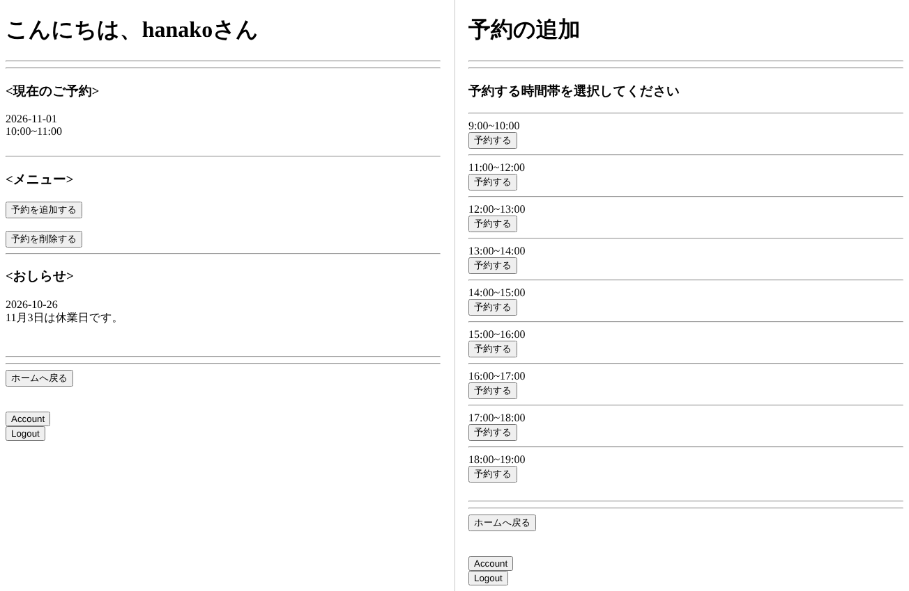

# 予約管理システム

PHP と MySQL で作った、1 時間単位の時間枠を予約できる Web アプリケーションです。利用者は空いている時間枠の予約と取り消しができ、管理者はユーザー、予約、お知らせを管理できます。

アプリ本体は `reservation_system.php` の 1 ファイルで、フレームワークは使っていません。



> [!WARNING]
> 学習用に作ったもので、認証とデータベース操作に安全対策をしていません。インターネットに公開する環境では使わないでください。詳しくは「[セキュリティについて](#セキュリティについて)」を参照してください。

## 機能

### 利用者

- サインアップ（ユーザー名、パスワード、生年月日、電話番号）とログイン
- 自分の予約の一覧表示
- 予約の追加（日付を入力し、空いている時間枠から選ぶ）
- 自分の予約の取り消し
- 自分宛て、または全員宛て（`everyone`）のお知らせの表示

### 管理者

- ユーザーの一覧表示と削除、管理者権限の付与と解除
- 全ユーザーの予約の一覧表示と削除
- お知らせの投稿（宛先、日付、本文）と削除

### 共通

- アカウント情報（パスワード、生年月日、電話番号）の変更
- ログアウト

### 予約枠

予約できるのは 9:00〜19:00 の 1 時間ごとの 10 枠です（9:00〜10:00 から 18:00〜19:00 まで）。1 つの時間枠を予約できるのは 1 人だけで、予約済みの枠は選択肢に表示されません。

## 必要な環境

- PHP 7.3 以上（`mysqli` 拡張が必要）
- MySQL または MariaDB

PHP 8.3 と MariaDB 10.11 で動作を確認しています。

## セットアップ

1. リポジトリをクローンします。

   ```bash
   git clone https://github.com/mimish0778/reservation-system.git
   cd reservation-system
   ```

2. データベースとテーブルを作ります。`schema.sql` はデータベース `web_db` と 3 つのテーブルを作成します。

   ```bash
   mysql -u root -p < schema.sql
   ```

3. 接続設定ファイルを作り、自分の環境に合わせて書き換えます。

   ```bash
   cp config.example.php config.php
   ```

   ```php
   $hostname = '127.0.0.1';
   $username = 'root';
   $password = 'your_password_here';
   $dbname   = 'web_db';
   ```

   `config.php` は `.gitignore` に含まれているため、コミットされません。

4. 管理者アカウントを作ります。画面から登録したユーザーは一般ユーザーになるため、最初の管理者はデータベースに直接追加します。

   ```sql
   INSERT INTO web_db.userTable (user, pass, isManager, birth, tel)
     VALUES ('admin', 'パスワード', 1, '2000-01-01', '0000000000');
   ```

   2 人目以降は、管理者が「ユーザを管理する」画面から権限を付与できます。

5. サーバーを起動します。PHP の組み込みサーバーを使う場合は次のとおりです。

   ```bash
   php -S localhost:8000
   ```

   ブラウザで http://localhost:8000/reservation_system.php を開きます。Apache などの Web サーバーを使う場合は、リポジトリのファイルをドキュメントルートに置いてください。

## 使い方

1. ログイン画面の「Sign Up」から利用者を登録します。登録するとそのままログインした状態になります。
2. ホーム画面の「予約を追加する」を押し、日付を `yyyymmdd` 形式（例: `20261101`）で入力して検索します。
3. 空いている時間枠の「予約する」を押すと予約が確定し、ホーム画面の「現在のご予約」に表示されます。
4. 予約を取り消すときは「予約を削除する」から選びます。

管理者でログインすると、ホーム画面に管理者メニュー（ユーザ、予約、投稿の管理）が表示されます。お知らせの宛先にユーザー名を入れるとそのユーザーだけに、`everyone` を入れると全員に表示されます。

## データベース

| テーブル | 内容 | 主な列 |
| --- | --- | --- |
| `userTable` | ユーザー | `user`（ユーザー名）、`pass`（パスワード）、`isManager`（1 なら管理者）、`birth`、`tel` |
| `reservationTable` | 予約 | `date`（日付）、`time`（開始時刻。9〜18）、`user`（予約したユーザー名） |
| `noticeTable` | お知らせ | `date`、`notice`（本文）、`addressee`（宛先のユーザー名または `everyone`） |

`schema.sql` は提出用のドキュメントから復元したもので、列の型には推定が含まれます。

## プロジェクト構成

```
.
├── reservation_system.php  アプリ本体
├── config.example.php      データベース接続設定のひな形
├── schema.sql              データベースとテーブルの定義
└── prototypes/             開発途中の初期版（参考）
    ├── main.php
    ├── signup.php
    └── questioner.php
```

画面の切り替えは、各フォームが送る `transition` の値で、データの追加・削除・更新は `operation` の値で振り分けています。すべての画面が `reservation_system.php` への POST で表示されます。

`prototypes/` は開発の途中で作った初期版で、本体の動作には必要ありません。`schema.sql` にない `questionTable` を参照しているため、そのままでは動きません。

## セキュリティについて

このアプリには次の問題があります。公開する場合は、少なくともこれらへの対策が必要です。

- **ログイン状態をセッションで管理していません。** ユーザー名とパスワードを各画面のフォームの hidden 項目に入れ、操作のたびに送り直して認証しています。
- **パスワードを平文で保存しています。** アカウント画面にも、現在のパスワードがそのまま表示されます。
- **SQL インジェクションへの対策がありません。** 入力値を SQL 文に直接埋め込んでおり、プリペアドステートメントやエスケープを使っていません。
- **操作の前にログインや権限を確認していません。** ユーザーや予約の削除、管理者権限の変更などは、ログインしていなくても該当するリクエストを送るだけで実行されます。
- 画面に表示する値をエスケープしていないため、クロスサイトスクリプティングの対策もありません。

## ライセンス

[MIT License](LICENSE)
